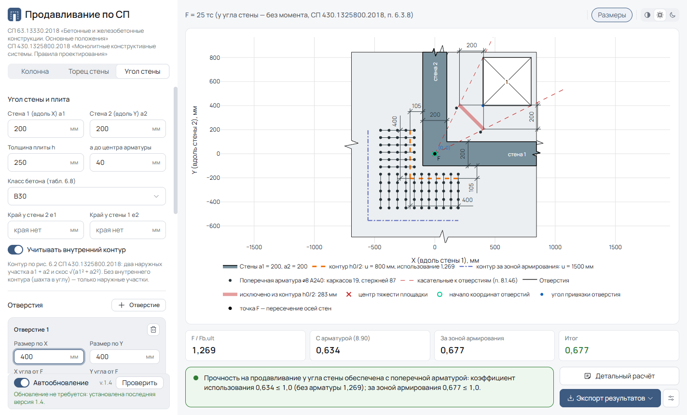

# Продавливание плиты

Расчёт железобетонных плит на продавливание у колонн, торцов и углов стен
по СП 63.13330.2018 и СП 430.1325800.2018.

 

  

  <b><a href="https://github.com/stf-24/punching-shear-calc-releases/releases/latest/download/Prodavlivanie-plity.exe">Prodavlivanie-plity.exe</a></b> — последняя версия · Windows 10 / 11, 64 бит · 135 МБ · без установки

## Скачать

**[⬇ Скачать «Продавливание плиты» 1.4 (программа .exe)](https://github.com/stf-24/punching-shear-calc-releases/releases/download/v1.4/Prodavlivanie-plity.exe)**

Все версии — на странице [Releases](https://github.com/stf-24/punching-shear-calc-releases/releases).
Рядом с exe лежит файл `.sha256` — контрольная сумма для проверки скачанного файла.

Установка не нужна: программа — один файл, запускается двойным щелчком и открывается в собственном
окне. Нужна 64-битная Windows 10 или 11 (с компонентом Microsoft Edge WebView2 Runtime — он входит
в Windows 11 и обновлённую Windows 10). У exe нет цифровой подписи: если Windows SmartScreen спросит
подтверждение — «Подробнее» → «Выполнить в любом случае».

Программа сама проверяет обновления при запуске (галочка «Автообновление» внизу левой панели),
скачивает новую версию и ставит её кнопкой «Обновить до …» или при следующем запуске.

## Что умеет

- **Колонна** прямоугольная, внутри плиты: сила F и моменты Mx, My (СП 63.13330.2018, пп. 8.1.46–8.1.52).
  Моменты вводятся полными вдоль осей, в расчёт идёт половина; моментная часть ограничивается 0,5·F/Fb,ult.
- **Торец стены** внутри плиты, у края и у фасада: П-образный контур, контур у края, незамкнутый контур
  от фасада (СП 430.1325800.2018, п. 6.3.8).
- **Угол стены** (Г-образный узел): контур по рис. 6.2 СП 430.1325800.2018 — два наружных участка
  и скос у внутреннего угла; расчёт только на силу F, без момента (п. 6.3.8). Галочка «Учитывать
  внутренний контур» — без неё (например, при шахте во внутреннем углу) скос не учитывается.
- **Поперечная арматура** во всех узлах: диаметр, класс (A240, A400, A500, B500), поперечный шаг;
  первый ряд, продольный шаг и число рядов подбираются по п. 10.3.17, проверка за зоной армирования.
- **Отверстия** у колонны, торца и угла стены — сколько угодно: размеры и угол привязки от центра
  колонны, середины торца стены или точки пересечения осей стен. Отверстие ближе 6h0 исключает часть контура между касательными
  (СП 63.13330.2018, п. 8.1.46); длина контура, моменты сопротивления и дополнительный момент
  от смещения центра тяжести пересчитываются автоматически.
- Бетон B3,5–B100, коэффициент условий работы γb1 = 1,0 или 0,9 (п. 6.1.12), усилия в тс или кН.
- **Итог цветом:** зелёный — прочность обеспечена; оранжевый — нужна поперечная арматура;
  красный — нужно менять сечение.
- **План узла** с расчётными контурами, каркасами арматуры, осями и размерами в чертёжном стиле.
- **Детальный расчёт** — все шаги с формулами, подстановкой чисел и ссылками на пункты и формулы норм.
- **Экспорт результатов** в Word (.docx) — расчёт с редактируемыми формулами и планом узла,
  оформленный для пояснительной записки; в PDF — через установленный Microsoft Word.

Не реализовано по нормам (сейчас — только ручным вводом длины контура u и Wb): колонна у края и в углу
плиты, угол стены у края плиты, непрямоугольные колонны, капители, круглые отверстия.
Подробности — в описании каждой версии.

## Условия

Автор: Stf. Программа распространяется бесплатно и безвозмездно и предоставляется «как есть»,
без каких-либо гарантий. Результаты расчёта проверяет и принимает инженер, выполняющий расчёт.

## История изменений

### [1.4](https://github.com/stf-24/punching-shear-calc-releases/releases/tag/v1.4)

Дата выпуска: 26.11.2026

Номер версии утвердил: Stf

#### Новое
- Вкладка «Угол стены» — продавливание плиты у угла стены (Г-образный узел) по СП 430.1325800.2018,
  п. 6.3.8, рис. 6.2: только сила F, без момента; контур — два наружных участка a1 + a2 и скос
  с катетами a1 и a2 у внутреннего угла.
- Галочка «Учитывать внутренний контур»: без неё скос не учитывается — например, когда во внутреннем
  углу шахта.
- У угла стены — края плиты, отверстия (касательные из точки пересечения осей стен), поперечная
  арматура с проверкой за зоной армирования, ручной ввод длины контура, план, детальный расчёт.
- Экспорт результатов: Word или PDF, оформление для пояснительной записки (Times New Roman 12,
  подписи рисунка и таблиц), параметры экспорта — марка колонны или стены, номера рисунка и первой
  таблицы, план и размеры; файл сохраняется в выбранную папку.
- Детальный расчёт и Word — в выбранных единицах (тс или кН).
- Плавные анимации: появление окна, переключение вкладок и единиц, раскрытие блоков, итог расчёта.
- Внизу левой панели номер версии пишется как «v.1.4».

#### Важно для пользователей
- Длины участков контура у угла стены в тексте п. 6.3.8 не заданы — они приняты по размерам
  рисунка 6.2.
- Угол стены у края плиты: схема рисунка 6.2 этот случай не описывает — контур обрезается краем,
  программа предупреждает об этом.
- PDF сохраняется через Microsoft Word; без установленного Word сохраните отчёт в формате Word.
- Версия 1.3 обновится до 1.4 сама (галочка «Автообновление»).

### [1.3](https://github.com/stf-24/punching-shear-calc-releases/releases/tag/v1.3)

Дата выпуска: 24.11.2026

Номер версии утвердил: Stf

#### Новое
- Учёт отверстий у колонны и у торца стены (СП 63.13330.2018, п. 8.1.46): блок «Отверстия», кнопка
  «+ Отверстие», число отверстий не ограничено.
- Отверстие задаётся размерами и углом, ближайшим к началу координат: у колонны — от её центра,
  у стены — от середины торца (X — поперёк стены, Y — вдоль стены). Размер со знаком минус
  откладывается через ось.
- Отверстие ближе 6h0 исключает часть контура между касательными из центра тяжести площадки;
  длина контура, центр тяжести (8.99), моменты сопротивления (8.98) и момент F·e0 пересчитываются
  автоматически, поперечная арматура считается по уменьшенной длине контура.
- На плане — отверстие чертёжным обозначением (контур с диагоналями), касательные и исключённые
  участки контура; в детальном расчёте и Word — раздел «Отверстия».
- Тёмная тема — окно тёмное целиком, включая план; светлая — светлое.
- Ширину левой панели можно менять, перетаскивая границу между панелью и планом.
- Строка автообновления пишется целиком: зелёным — обновление не требуется, красным — требуется.

#### Важно для пользователей
- У торца стены площадкой передачи нагрузки принята часть стены внутри контура: от неё отсчитываются
  6h0, из её центра тяжести проводятся касательные (норма площадку для стены не определяет).
- Отверстия только прямоугольные; при ручном вводе длины контура они не учитываются.

### [1.2.2](https://github.com/stf-24/punching-shear-calc-releases/releases/tag/v1.2.2)

Дата выпуска: 16.11.2026

Номер версии утвердил: Stf

#### Новое
- Новые версии публикуются на этой странице.
- Когда новая версия скачана, внизу левой панели появляется кнопка «Обновить до …».

#### Исправлено
- После автообновления новая версия запускается без ошибки.

#### Важно для пользователей
- Версию 1.2.1 обновите вручную: скачайте 1.2.2 по ссылке выше. Начиная с 1.2.2 программа
  обновляется сама.

### 1.2.1

Дата выпуска: 16.11.2026

Номер версии утвердил: Stf

#### Новое
- Автообновление: при запуске программа проверяет новую версию, скачивает её в фоне и проверяет
  целостность файла. Без галочки «Автообновление» в сеть не обращается.
- Коэффициент условий работы бетона γb1 = 1,0 / 0,9 (СП 63.13330.2018, п. 6.1.12) — в расчёте,
  отчёте и Word.
- Программа стала меньше: 131 МБ вместо 414 МБ.

#### Исправлено
- Торец стены у угла плиты: если от контура остаётся один прямой участок, расчёт больше не завершается
  ошибкой — моментная часть принимается по ограничению 0,5·F/Fb,ult (п. 8.1.46).
- Расчётное сопротивление Rbt в формулах отчёта выводится с той же точностью, что в расчёте.

### 1.1

Дата выпуска: 16.11.2026

Номер версии утвердил: Stf

#### Новое
- Программа в собственном окне, светлая и тёмная темы, логотип.
- Детальный расчёт: акценты на итогах, таблица исходных данных, ссылки на пункты норм.
- Размеры на плане следуют включённым контурам и не перекрывают оси, контуры и каркасы.

### 1.0

Дата выпуска: 15.11.2026

Номер версии утвердил: Stf

#### Новое
- Первая версия: колонна и торец стены, поперечная арматура, план узла, детальный расчёт, Word.
